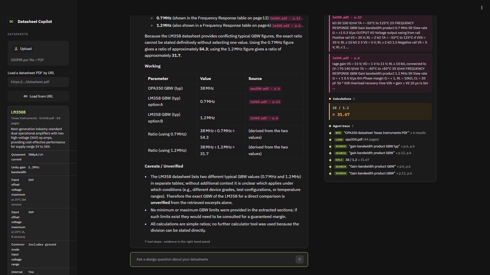

# Datasheet Copilot

A design assistant for electronics engineers and students that answers questions from component datasheets. It cites the datasheet page behind every spec and computes every number with units.

Built for the Nebius x NVIDIA Global AI Hackathon (Best Apps and Agents track). It runs on **NVIDIA Nemotron** open models served by **Nebius Token Factory**.

- **Live demo:** https://datasheet-copilot.streamlit.app/ (if it has been idle, Streamlit takes about 30 seconds to wake it)
- **Licence:** [MIT](LICENSE) (OSI-approved)



*Asked to compare the TI OPA350 with the loaded LM358, the agent found the OPA350 datasheet with Tavily, downloaded it, searched both, and computed the ratio with the calculator. Every value carries a page citation, and the evidence panel shows the passage behind each one.*

## The problem

Answering a design question from datasheets means finding the right value in a 60-page PDF, checking whether it is typical or worst-case, and then doing the arithmetic. A general chatbot can do this, but it often recalls specs from memory and does the arithmetic in its head. That produces a confident number with no way to check it.

Datasheet Copilot is built so that each answer can be checked:

- **Specs come only from the loaded datasheets**, cited inline as `[document p.N]`. If the datasheet does not state a value, the app says so rather than guessing.
- **The model does no arithmetic itself.** Every calculation goes through a unit-aware calculator (`pint`), so it catches mistakes like adding volts to amps.
- **Every step is shown.** The evidence panel beside each answer shows the exact passage behind each citation, and a trace of every search (with the pages it hit), web lookup, download and calculation (inputs with units → result).
- **The app checks the model.** After each answer, every `[doc p.N]` citation is compared with the pages actually retrieved in that turn, and any claim of using the calculator is compared with the calculate calls actually made. An answer that fails is sent back once to verify or remove the claim, and a badge under every answer shows the result: how many cited pages were matched to retrieved passages, or which were not.

## What it does

- Upload datasheet PDFs, or load one by URL.
- **Spec cards**: on upload, Nemotron Nano extracts the part number and headline specs, each with its page number.
- **Agentic Q&A**: Nemotron Super plans the answer and calls these tools:
  - `search_datasheets`: BM25 search over page-tagged chunks, returns passages with document and page
  - `calculate`: safe expression evaluator with units, dB helpers, `parallel()`, and physical constants
  - `web_search` (Tavily, optional): finds manufacturer datasheet PDFs or alternative parts
  - `fetch_datasheet_pdf`: downloads a public PDF and adds it to the library (private network addresses are refused)
  - `list_datasheets`

Example questions:

- What is the -3 dB bandwidth, and what 10–90% rise time does that imply?
- At the rated responsivity, what output swing do I get into 50 Ω for 1 mW input?
- Compare the key specs of the loaded op-amps in a table, with citations.

## How NVIDIA Nemotron and Nebius are used

| Component | Model / service | Why |
|---|---|---|
| Agent reasoning and tool calling | NVIDIA **Nemotron 3 Super** (`nvidia/nemotron-3-super-120b-a12b`) on Nebius Token Factory | Multi-step planning: which spec to look up, which formula applies, worst-case vs typical |
| Spec-card extraction on upload | NVIDIA **Nemotron 3 Nano** (`nvidia/NVIDIA-Nemotron-3-Nano-30B-A3B`) on Nebius Token Factory | Fast, low-cost structured extraction that runs once per document |
| Inference API | **Nebius Token Factory** (OpenAI-compatible) | Every agent turn and spec card is a runtime call to `api.tokenfactory.nebius.com` |
| Web search (optional) | Tavily | Finds datasheets that are not loaded yet |

### How Nemotron is used

- **Nemotron 3 Super is the agent.** `copilot/agent.py` runs a tool-calling loop in which Super chooses which tools to call: it can request several datasheet searches in one step, fetch a missing datasheet, then call the calculator with the values it found. Its answer is checked against the tool results before it is shown (see above).
- **Tool use is enforced on the first step.** The first call of each turn uses `tool_choice="required"`, so Super has to search before it answers. With tool use left optional, it answered a follow-up comparison from memory with citations to pages it had never retrieved.
- **Nemotron 3 Nano reads every new datasheet.** `copilot/specs.py` sends the first pages to Nano for a JSON spec card at temperature 0. Reasoning is turned off for this call (`chat_template_kwargs: {"enable_thinking": false}`): with it on, Nano could spend the whole output budget thinking and return nothing.
- **Reasoning is also turned off for the agent's forced final answer.** That call is made when the loop ends without an answer (step limit reached or an empty reply), so it should answer from the results it already has, not think again.

### Where Token Factory accelerated the build

- **No infrastructure.** Both Nemotron models are served from one endpoint with one API key, so there were no GPUs to provision or model servers to run. The app is a thin Streamlit front end that deploys free on Streamlit Community Cloud.
- **Standard SDK.** Token Factory is OpenAI-compatible, so the app uses the official `openai` Python package with only `base_url` changed (`copilot/llm.py`). Tool calling, `tool_choice` and JSON output worked with the standard request format.
- **Right-sized models through configuration.** Moving between Nemotron sizes is a change to one environment variable, which made it quick to try Super and Nano on each job and keep the cheaper model where it was good enough.
- **Fast setup checks.** `scripts/check_setup.py` lists the models available to your key via `/v1/models` and makes a test tool call, so a wrong model ID or key shows up before the app runs.
- **Controlled spend.** Every request is routed through a metered client (`copilot/usage.py`) that records the token usage Token Factory returns and refuses calls beyond per-session, per-day and all-time caps.

Other Nebius services: none. Inference is the only Nebius service this project uses.

## Architecture

```
Streamlit UI (app.py)
  │  upload / URL ──► Library: pypdf text → page-tagged chunks → BM25 index
  │  spec card    ──► Nemotron Nano (Token Factory)
  │  question     ──► Agent loop (copilot/agent.py)
  │                     Nemotron Super (Token Factory) ⇄ ToolBox
  │                       search_datasheets · calculate (pint) · web_search (Tavily)
  │                       fetch_datasheet_pdf · list_datasheets
  │                     grounding check: cited pages retrieved? calculator claims real?
  ▼
  Answer with [doc p.N] citations + evidence panel (passages and tool trace)
```

| Path | Purpose |
|---|---|
| `app.py` | Streamlit interface |
| `copilot/agent.py` | Tool-calling loop with a step limit, grounding checks and a final no-tools answer |
| `copilot/llm.py` | Token Factory client and output clean-up |
| `copilot/usage.py` | Metered client and token caps |
| `copilot/tools.py` | Tool schemas and handlers |
| `copilot/calculator.py` | AST whitelist evaluator with `pint` units |
| `copilot/library.py` | PDF extraction, chunking, BM25 search |
| `copilot/specs.py` | Spec-card extraction prompt |
| `copilot/fetch.py` | PDF download with size limit and private-address check |
| `scripts/check_setup.py` | Verifies key, model IDs and tool calling |
| `tests/` | Calculator, retrieval, citation and agent-loop tests (no API key needed) |

## Setup

Requires Python 3.11 or newer.

```bash
git clone https://github.com/Aatikah-Sheikh/datasheet-copilot.git
cd datasheet-copilot
python -m venv .venv
# Windows: .venv\Scripts\activate    macOS/Linux: source .venv/bin/activate
pip install -r requirements.txt
cp .env.example .env    # then add NEBIUS_API_KEY (and optionally TAVILY_API_KEY)
python scripts/check_setup.py
streamlit run app.py
```

Get a Token Factory API key at [tokenfactory.nebius.com](https://tokenfactory.nebius.com). Tavily keys are at [tavily.com](https://tavily.com).

Open http://localhost:8501 and click **Load TI LM358 op-amp** to try it without uploading anything.

Optional settings in `.env` (see `.env.example`):

| Variable | Default | Purpose |
|---|---|---|
| `MAX_TOKENS_PER_SESSION` | 100000 | Token cap for one browser session |
| `MAX_TOKENS_PER_DAY` | 300000 | Token cap per UTC day, across all sessions |
| `MAX_TOKENS_TOTAL` | 1000000 | All-time token cap |
| `NEBIUS_REASONING_MODEL` | `nvidia/nemotron-3-super-120b-a12b` | Agent model |
| `NEBIUS_FAST_MODEL` | `nvidia/NVIDIA-Nemotron-3-Nano-30B-A3B` | Spec-card model |

### Tests

```bash
pip install pytest
pytest
```

The tests use a stub client, so they run without an API key.

### Deploying on Streamlit Community Cloud

1. Push this repository to GitHub.
2. At [share.streamlit.io](https://share.streamlit.io), create an app from the repository with `app.py` as the entry point.
3. Under **Advanced settings → Secrets**, add:

   ```toml
   NEBIUS_API_KEY = "..."
   TAVILY_API_KEY = "..."
   ```

## Limitations

- Text extraction uses `pypdf`. Scanned datasheets with no text layer are rejected, and some tables extract with jumbled columns, so the agent may miss a value that is only in a graph or image.
- Retrieval is keyword-based (BM25). It handles part numbers and spec names well, but it can miss a paraphrase.
- Spec cards are produced by a language model. They carry page numbers so each value can be checked, but check them before relying on them.
- The library is per session and held in memory. Uploaded datasheets are not stored.

- The grounding check catches citations to pages that were never retrieved and false claims of using the calculator. It does not yet catch arithmetic the model does silently in its prose.

## Licence

[MIT](LICENSE), an OSI-approved open-source licence.
